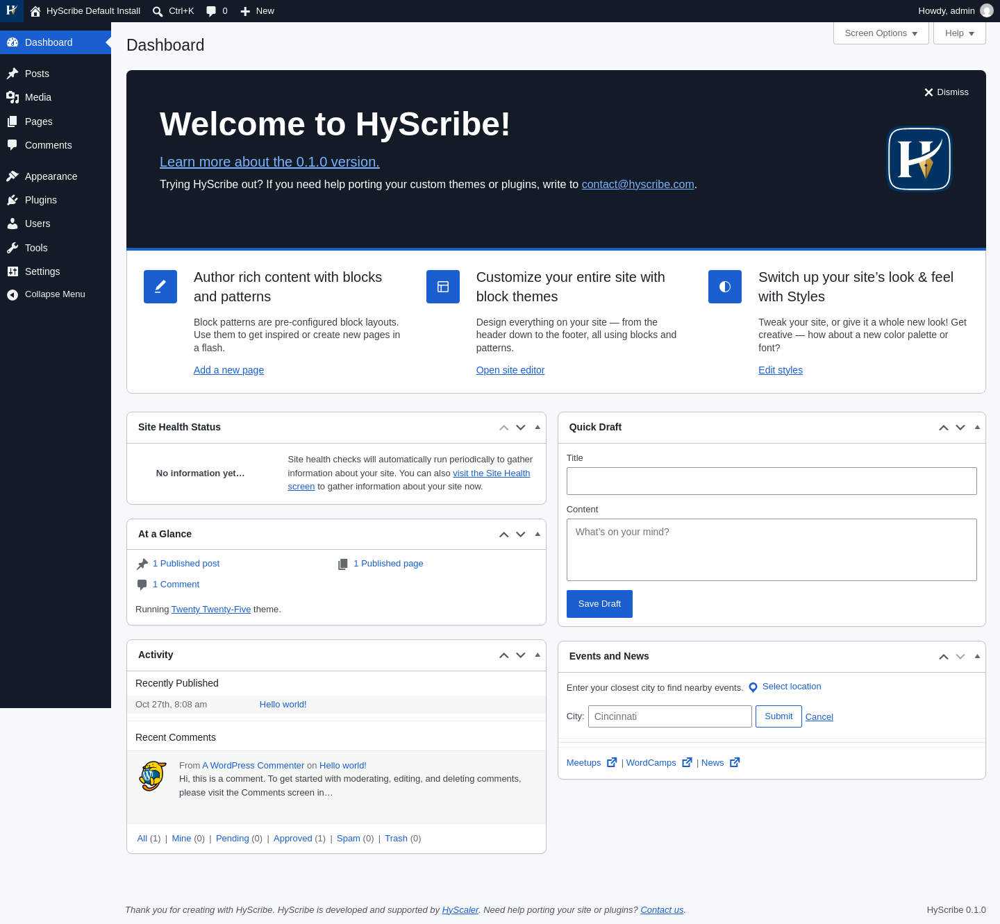

<p align="center">
  
</p>

<h1 align="center">HyScribe</h1>

<p align="center"><b>A drop-in replacement for WordPress, written in Rust.</b></p>

<p align="center">
  <a href="LICENSE"></a>
  <a href="https://github.com/hyscaler/HyScribe/releases/latest"></a>
  <a href="https://docs.hyscribe.com"></a>
</p>

<p align="center">
  <a href="https://hyscribe.com"><b>Website</b></a> ·
  <a href="https://docs.hyscribe.com"><b>Docs</b></a> ·
  <a href="#quickstart"><b>Install</b></a> ·
  <a href="https://github.com/hyscaler/HyScribe/releases/latest"><b>Latest release</b></a> ·
  <a href="mailto:contact@hyscribe.com"><b>Porting help</b></a>
</p>

Point the `hyscribe` binary at an existing WordPress database and `wp-content` folder, answer a short setup wizard, and the site is served by a single native process. No PHP runtime, no schema migration, and the database stays readable by PHP WordPress, so you can switch back at any time.

PHP2Shell (October 2026) showed that every WordPress site can be compromised through the PHP runtime itself, with no plugin at fault. HyScribe keeps WordPress's data, URLs and ecosystem, and replaces the runtime with memory-safe Rust and sandboxed plugins. See [docs/VISION.md](docs/VISION.md).

> [!WARNING]
> **Not yet production ready.** HyScribe is an early release in active development: it has had no external security audit, parts of hs-admin and the REST API still answer `501 Not Implemented`, and behaviour may change between releases. Try it on a copy of a site, not on a live one, and keep backups. See [PROGRESS.md](PROGRESS.md) for where it stands.

<p align="center">
  
</p>

## Why HyScribe

| | |
| --- | --- |
| **Your site, unchanged** | The same database, the same URLs, the same content and users. Nothing is migrated and no table is altered |
| **No PHP to attack** | A memory-safe Rust core with secure defaults. No PHP file is ever run, and every parser of untrusted input is fuzzed ([docs/SECURITY_MODEL.md](docs/SECURITY_MODEL.md)) |
| **Plugins in a sandbox** | Extensions run as WebAssembly packages with declared permissions, time and memory limits, instead of code with the run of the server |
| **One binary** | A static build with no runtime dependency but the database. Unpack, start, finish setup in the browser |
| **Checked against WordPress** | PHP WordPress is the test oracle: pages, REST answers and database writes are compared with what PHP produces |
| **A way back** | PHP WordPress can read everything HyScribe wrote. A test suite proves it on every release |

## What it can do

[v0.1.0](https://github.com/hyscaler/HyScribe/releases/tag/v0.1.0) (2026-11-26) is the current release. On the default WordPress install it drops in against the same database, serves it, writes to it through hs-admin and the REST API with the same checks as PHP, and hands it back to PHP WordPress with no check failing. The acceptance runs are recorded in [docs/ACCEPTANCE.md](docs/ACCEPTANCE.md).

Legend: ✅ working today, 🚧 in progress, 🔜 coming up, ❌ not supported.

| Area | Status | What you get |
| --- | --- | --- |
| Drop in on an existing site | ✅ | One binary and a setup wizard serve a WordPress 7.0 or 7.1 site from its database and `wp-content`, with no schema change |
| Pages match PHP WordPress | ✅ | On the default install, pages match PHP WordPress byte for byte |
| Switch back to PHP WordPress | ✅ | The database stays readable by PHP WordPress; checked by its own test suite |
| Block themes | ✅ | Twenty Twenty-Two to Twenty-Five are built in and switch from Appearance; a site on another theme is served with Twenty Twenty-Five |
| Blocks and formatting | ✅ | Core blocks, global styles and WordPress's text formatting, checked against PHP |
| hs-admin (`/hs-admin/`) | ✅ | The default install's screens: posts, pages, media, comments, categories and tags, users, settings |
| Block editor and site editor | ✅ | Writing and editing posts and pages; templates, template parts, patterns and global styles |
| Media and uploads | ✅ | Images with their sizes made, and documents, spreadsheets, presentations, archives, text and CSV, Word, Excel and PowerPoint 97 to 2003 files, PDFs (kept without preview images), MP3 files with their tags and cover pictures, and MP4, M4A, M4V, QuickTime and 3GPP files with their cover pictures; Ogg, FLAC, Windows Media, Matroska, AVI and FLV files answer `501` until their readers are ported |
| REST API | ✅ | Reads for most core routes; writes for posts, pages, templates, global styles, menus, patterns, terms, settings, comments and users |
| Login and users | ✅ | Login at `/hs-login` with existing accounts, lost and reset password, registration, roles and capabilities; logged in users see their private posts, drafts and previews on the site as each role does in PHP WordPress |
| Comments | ✅ | Posting and moderating |
| Mail | ✅ | Through an SMTP relay you configure |
| Scheduled jobs | ✅ | WordPress's six core jobs run in the service |
| Release archives | ✅ | Reproducible static builds for Linux x86_64 and arm64, with checksums, an SBOM and build provenance |


### In progress

| Area | Status | Where it stands |
| --- | --- | --- |
| Classic themes | 🚧 | The host side is under way (the template hierarchy, the first template tags, the head and footer); the first port, Hello Elementor, is being built as a separate package |
| Plugins on the extension runtime | 🚧 | Plugins run as sandboxed WebAssembly packages: installing a signed local package, activating and deactivating work; the SDK is at 0.4, with admin pages and the settings API, and no popular plugin is ported yet |
| Signed packages and the hosted registry | 🚧 | Signing, install by name and the update check are built ([ADR 0024](docs/adr/0024-registry-and-package-signing.md)); they start working once the registry has its keys and address |
| The rest of hs-admin and the REST API | 🚧 | What is not ported answers `501 Not Implemented` and still works in PHP WordPress on the same database: [docs/operators/not-supported.md](docs/operators/not-supported.md) |

### Not supported

| Area | Status | Note |
| --- | --- | --- |
| WordPress's PHP plugins | ❌ | They never run: HyScribe has no PHP runtime. A plugin needs a port to the extension runtime |
| Multisite | ❌ | Refused at start; planned (M9) |
| XML-RPC | ❌ | Planned (M9) |
| Database TLS | ❌ | Not supported yet |

## Roadmap

No dates: each step ships when its checks against PHP WordPress pass. The plan is in [docs/MVP.md](docs/MVP.md) (phases) and [docs/ROADMAP.md](docs/ROADMAP.md) (milestones, with what is done and left in each).

### Coming up

| Order | What | Status |
| --- | --- | --- |
| 1 | Classic themes: Hello Elementor, then Twenty Twenty-One with nav menus, widget areas, theme mods and the Customizer | 🚧 |
| 2 | Installing themes | 🔜 |
| 3 | The rest of the plugin SDK: uploads, rewrite rules, plugins' own tables (admin pages and the settings API are in SDK 0.4) | 🚧 |
| 4 | Ports of three reference plugins: Contact Form 7, Yoast SEO, Elementor (its front end, then its editor) | 🔜 |
| 5 | A security review of the extension runtime, and the MVP's checks rerun with each theme and plugin | 🔜 |
| 6 | The hosted registry's keys and address, so install by name and update checks work | 🔜 |
| 7 | The compatibility scanner, `hyscribe doctor` and the new site installer | 🔜 |
| 8 | Agent porting of WordPress plugins and themes, with a public registry of ports | 🔜 |
| 9 | Multisite, XML-RPC, translations and caching | 🔜 |
| 10 | 1.0: an external security audit, long fuzzing, benchmarks against PHP WordPress, more platforms and the upgrade path | 🔜 |

### Milestones

| Milestone | Status | Note |
| --- | --- | --- |
| MVP: a drop-in replacement for a default install | ✅ | Met 2026-11-20, [docs/ACCEPTANCE.md](docs/ACCEPTANCE.md) |
| M1 Foundations | 🚧 | The gates, configuration, service and release pipeline are done |
| M2 Setup wizard and compatibility scanner | 🚧 | The wizard for an existing site is done |
| M3 Read-only front end | 🚧 | The default install matches PHP |
| M4 Authentication and users | 🚧 | Login, sessions, roles and capabilities are done |
| M5 Write path (REST API, admin, media) | 🚧 | Most writes are done |
| M6 Extension SDK and runtime | 🚧 | The runtime, SDK 0.4 and signed packages are built |
| M7 Theme system | 🚧 | Block themes are done; classic themes are under way |
| M8 Agent porting pipeline | 🔜 | Not started |
| M9 Breadth | 🚧 | Cron runs in the service |
| M10 1.0 hardening and release | 🔜 | Not started |

The live checklist is [PROGRESS.md](PROGRESS.md).

## Quickstart

Linux, x86_64 or arm64. You need an existing WordPress 7.0 or 7.1 site's database (MariaDB or MySQL) and its `wp-content` folder; try it on a copy.

```bash
curl -fLO https://github.com/hyscaler/HyScribe/releases/latest/download/hyscribe-latest-linux-amd64.tar.gz   # or -arm64
curl -fLO https://github.com/hyscaler/HyScribe/releases/latest/download/SHA256SUMS.txt
sha256sum -c SHA256SUMS.txt --ignore-missing
gh attestation verify hyscribe-latest-linux-amd64.tar.gz --repo hyscaler/HyScribe
tar -xzf hyscribe-latest-linux-amd64.tar.gz && cd hyscribe
./hyscribe service start      # then finish setup in the browser
```

The operator documentation, also shipped in the archive as `hyscribe/docs/`, covers installing, configuration, running the service, switching a site over and back, backups, upgrades, security and what is not supported yet: [docs/operators/](docs/operators/README.md). The design behind it is in [docs/DEPLOYMENT.md](docs/DEPLOYMENT.md).

## Coming from WordPress

- **Your themes:** the block themes Twenty Twenty-Two to Twenty Twenty-Five are built in. A site on another theme is served with Twenty Twenty-Five for now; classic themes are under way.
- **Your plugins:** PHP plugins do not run, because there is no PHP. A plugin needs a port to the extension runtime, and no popular plugin is ported yet.
- **Need a custom theme or plugin ported?** Write to [contact@hyscribe.com](mailto:contact@hyscribe.com).
- **Changed your mind?** Stop HyScribe and start PHP WordPress on the same database. [Switching a site over and back](docs/operators/switching.md) has the steps.

## FAQ

<details>
<summary><b>Is it ready for my live site?</b></summary>
<br>

Not yet. v0.1.0 is an early release with no external security audit, and parts of the admin and the REST API still answer `501 Not Implemented`. Run it on a copy of a site and keep backups.

</details>

<details>
<summary><b>Does it change my database?</b></summary>
<br>

No table is altered and nothing is migrated. HyScribe writes only what PHP WordPress would write, which is checked against PHP for every kind of write.

</details>

<details>
<summary><b>Can I go back to PHP WordPress?</b></summary>
<br>

Yes, at any time. The database stays readable by PHP WordPress, and a switch-back test suite runs on every release.

</details>

<details>
<summary><b>Will my plugins work?</b></summary>
<br>

Not as they are. WordPress's PHP plugins never run on HyScribe. Plugins are ported to sandboxed WebAssembly packages on HyScribe's extension SDK; the runtime and SDK 0.4 are in this release, and the first ports are on the roadmap. For help porting your own, write to [contact@hyscribe.com](mailto:contact@hyscribe.com).

</details>

<details>
<summary><b>Which WordPress versions and themes?</b></summary>
<br>

Sites on WordPress 7.0 or 7.1. The block themes Twenty Twenty-Two to Twenty Twenty-Five are built in; classic themes are in progress.

</details>

<details>
<summary><b>What does it cost?</b></summary>
<br>

Nothing. HyScribe is open source under the AGPL-3.0-or-later licence.

</details>

## Built with

Rust throughout: one static binary serves the site, hs-admin and the REST API over MariaDB or MySQL. Extensions run on a WebAssembly component runtime. PHP WordPress is used only as the test oracle.

## Going further

- [docs.hyscribe.com](https://docs.hyscribe.com) and [docs/operators](docs/operators): installing, configuration, running the service, switching a site over and back, backups, upgrades and security.
- [What is not supported](docs/operators/not-supported.md): the full list of what still answers `501` or differs from WordPress.
- [docs/SECURITY_MODEL.md](docs/SECURITY_MODEL.md) and [docs/COMPATIBILITY.md](docs/COMPATIBILITY.md): the security rules and the compatibility contract.
- [docs/EXTENSIONS.md](docs/EXTENSIONS.md): writing plugins for the extension runtime.
- [docs/ROADMAP.md](docs/ROADMAP.md) and [PROGRESS.md](PROGRESS.md): the plan and the live checklist.

## Build from source

```
reference/default-install/db.sh up        # MariaDB with a fresh WordPress 7.1 install
cargo build --release -p hyscribe
mkdir -p try && cp target/release/hyscribe try/
printf 'DB_HOST=127.0.0.1\nDB_PORT=33061\nDB_NAME=wordpress\nDB_USER=wordpress\nDB_PASSWORD=reference-only\nWP_HOME=http://127.0.0.1:8080\n' > try/.env
chmod 600 try/.env && try/hyscribe service start   # then open http://127.0.0.1:8080/
```

The build downloads the pinned WordPress release from wordpress.org with `curl` and unpacks its `wp-includes` with `tar`, after checking its SHA-256, so the build host needs both and network access. For an offline build, point `HYSCRIBE_WORDPRESS_TARBALL` at a copy of `wordpress-7.1.3.tar.gz`.

## Development

Rust stable 1.99 or later.

```
cargo test --workspace                 # all tests
cargo llvm-cov --workspace --ignore-filename-regex '/tests/' \
  --fail-under-lines 100 --fail-under-regions 100   # the coverage gate
cargo mutants --workspace              # mutation testing
cargo deny check                       # licenses, advisories, sources
reference/default-install/build.sh     # rebuild the default install fixture
scripts/package.sh x86_64-unknown-linux-musl dist   # release archive
scripts/smoke-test.sh dist/hyscribe_*_linux_amd64.tar.gz   # install it and run the service
```

Every change ships with tests, and coverage stays at 100% ([docs/TESTING.md](docs/TESTING.md)).

## Contributing

Bug reports, compatibility reports, docs fixes, tests and code are welcome: see [CONTRIBUTING.md](CONTRIBUTING.md) and the [Code of Conduct](CODE_OF_CONDUCT.md). Report vulnerabilities privately, as [SECURITY.md](SECURITY.md) says.

## License

The code is AGPL-3.0-or-later. See [LICENSE](LICENSE) and [ADR 0004](docs/adr/0004-licensing.md).

HyScribe is developed and supported by [HyScaler](https://hyscaler.com). A copy or a fork keeps that attribution, as [NOTICE](NOTICE) says.

The HyScribe name and logo are not covered by that licence; see [brand/README.md](brand/README.md).

WordPress is a registered trademark of the WordPress Foundation. HyScribe is an independent project and is not affiliated with, sponsored by or endorsed by the WordPress Foundation or Automattic.
